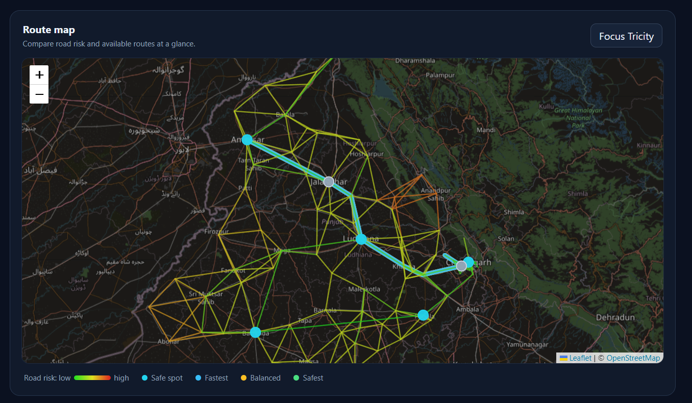

<div align="center">

# SAFEPATH

### SHORTEST IS NOT ALWAYS SAFEST.

*A safety-aware route planner for Punjab, built on Dijkstra's algorithm in C++.*


[The problem](#the-problem) · [How it works](#how-it-works) · [Run it](#run-it) · [Limitations](#limitations)

</div>

SafePath finds three routes between towns of Punjab: the **fastest**, the **safest**, and a **balanced** one. Google Maps-style navigation uses shortest-path algorithms with distance (or time) as the cost. SafePath keeps the same algorithm but changes what an edge costs, so each road also carries a **risk score** and the route can avoid risky stretches, especially at night.



*Dashboard snapshot: risk-coloured roads, and the fastest (blue), balanced (yellow) and safest (green) routes drawn on a real map.*

> [!IMPORTANT]
> Risk scores in SafePath are **subjective estimates** based on road type and local knowledge. They are not official crime data. Distances are **estimates** (Haversine distance x 1.25), not exact road distances. SafePath is an educational project and is not meant for real-world navigation decisions.

## The problem

The shortest road is not always the one people feel safest on. A short stretch through a quiet, poorly lit area can be a worse choice than a slightly longer highway, especially after dark. Standard shortest-path routing has no way to express that. SafePath adds a risk dimension to the graph and lets the user compare the trade-off directly.

| 70+ | 130+ | 3 | 1 |
|---|---|---|---|
| Punjab towns as graph nodes | Roads as weighted edges | Route modes: fastest, balanced, safest | Algorithm: Dijkstra with a min-heap |

*(Numbers grow as more towns and roads are added.)*

```
Town coordinates -> Haversine distance x 1.25 -> Graph (adjacency list)
   -> Dijkstra (min-heap) x 3 modes x day/night -> data.js -> Leaflet dashboard
```

## How it works

Every road has a **distance** and a **risk score** from 1 (very safe) to 10 (very unsafe). Dijkstra runs on a combined cost:

```
edge cost = distance x (alpha + beta x risk)
```

| Mode | alpha | beta | What it prefers |
|------|-------|------|-----------------|
| Fastest | 1.0 | 0.0 | Shortest distance only |
| Balanced | 1.0 | 0.5 | A mix of distance and safety |
| Safest | 0.1 | 1.0 | Safety first, even if the route is longer |

At **night**, the risk of every road is multiplied by 1.5, so the safest route can change between day and night. The Dijkstra code is the same for all modes. Only the edge weight changes.

### Data structures and algorithms

| Concept | Where it is used | Complexity |
|---------|------------------|------------|
| Graph (adjacency list) | Towns are nodes, roads are weighted edges | O(V + E) space |
| Min-heap (priority queue) | Picks the next closest town in Dijkstra | O(log V) per operation |
| Dijkstra's algorithm | Finds the cheapest route in each mode | O((V + E) log V) |
| Parent array | Rebuilds the actual path from destination to source | O(V) |
| Haversine formula | Calculates distance between two coordinates | O(1) |
| BFS | Checks that the road network is connected | O(V + E) |

### Risk model

Risk is **not random**. It comes from the road type, and local knowledge can override it:

| Road type | Base risk |
|-----------|-----------|
| Main highway corridors (such as the GT Road / NH44 stretch) | 1 to 2 |
| Link between two big towns | 3 |
| Link involving a small town | 5 |
| Remote or isolated stretches | 6 to 7 |

A separate `applyLocalKnowledge()` table in `main.cpp` lets the author override individual roads, for example a quiet and isolated stretch can be set higher than its road type suggests.

## What the dashboard does

- Shows an interactive map (Leaflet + OpenStreetMap) with every road coloured from green (low risk) to red (high risk)
- Lets you choose a start, a destination and **Day or Night**
- Draws the fastest, balanced and safest routes on top of the map
- Shows distance, average risk and the full path for each route
- Shows a one-line insight, for example how much longer the safest route is and how much risk it saves

## Run it

1. Compile and run the C++ program. It generates `data.js`:
   ```
   cd src
   g++ -std=c++11 main.cpp -o main
   ./main          (on Windows: .\main.exe)
   ```
2. Open `src/dashboard.html` in a browser. Internet is needed for the map tiles.
3. Pick a start, a destination and Day or Night, then compare the three routes.

## Project structure

```
safepath/
  src/
    main.cpp         Classes: Location, Road, Graph, RouteResult, RouteFinder, RiskModel, DataExporter
    dashboard.html   Dashboard (Leaflet + OpenStreetMap)
    data.js          Generated by main.cpp and read by the dashboard
  docs/
    dashboard.jpg    Screenshot used in this README
  data/
  tests/
```

## Limitations

- Risk scores are estimates, not official data. A real system would use crime statistics, street-light data and live user reports.
- Roads are approximated by connecting nearby towns, so a few links may not exist exactly like this in real life.
- Distances are estimated, not measured on real roads.
- Traffic is not modelled.

## Future scope

- Real crime and street-light data for risk scoring
- Live traffic and user-reported incidents
- A* search for faster queries
- Detailed city-level maps, such as the sectors and important roads of Chandigarh

## Author

**Khushdeep Kaur**, B.E. Computer Science Engineering, Chandigarh University.
Built as a DSA mini project.